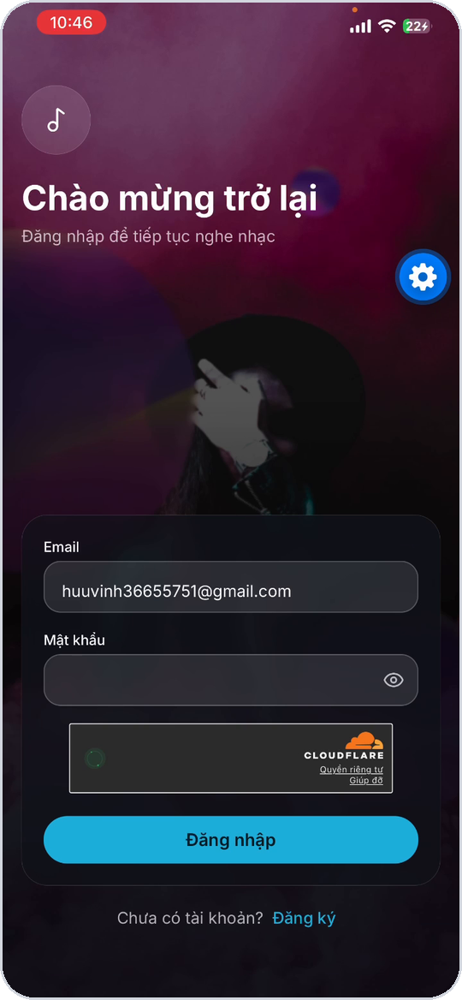
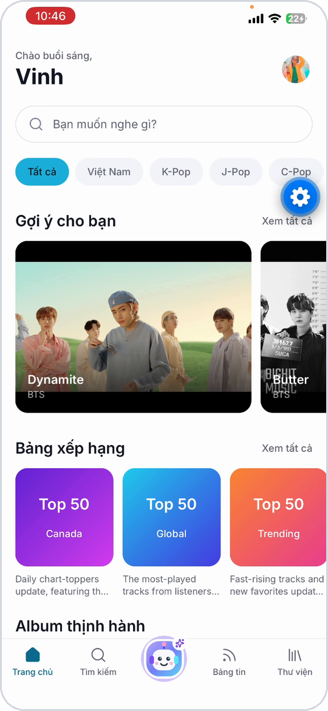
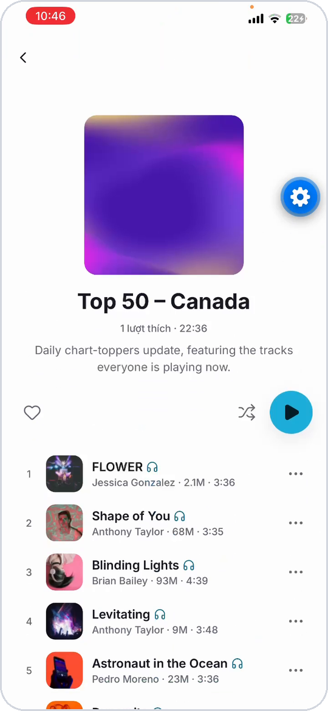
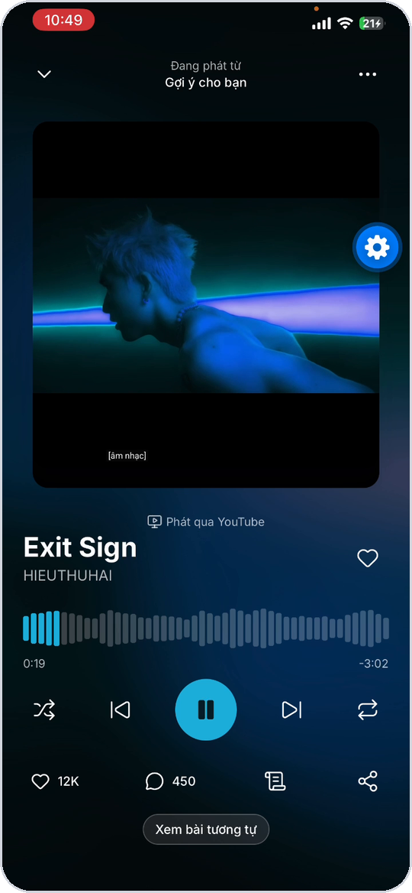
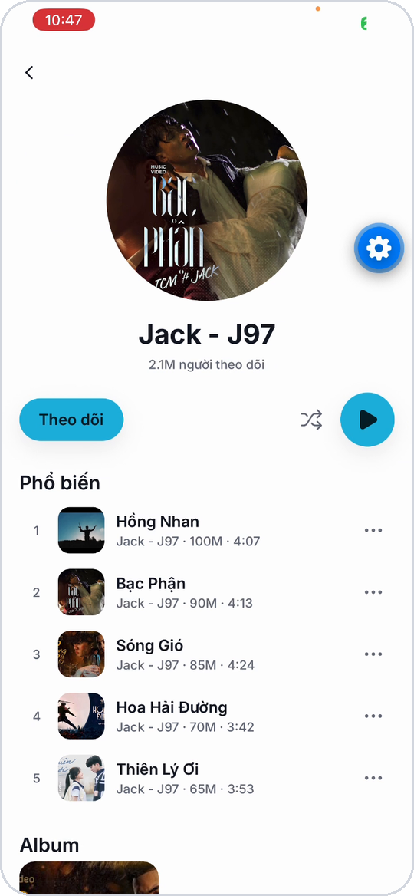
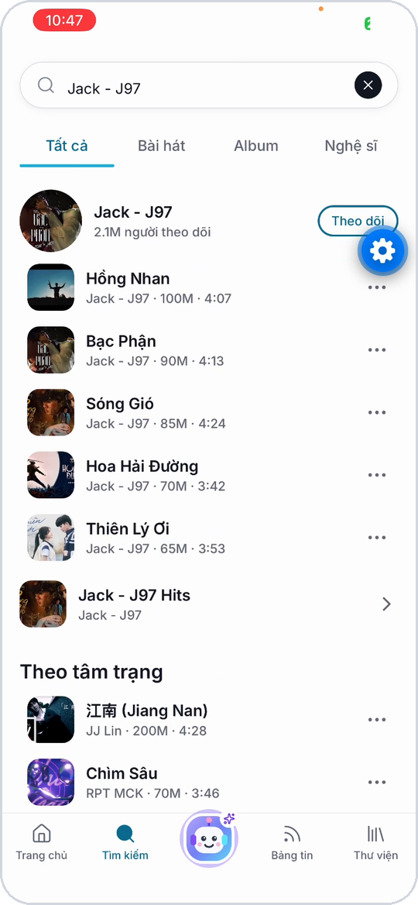
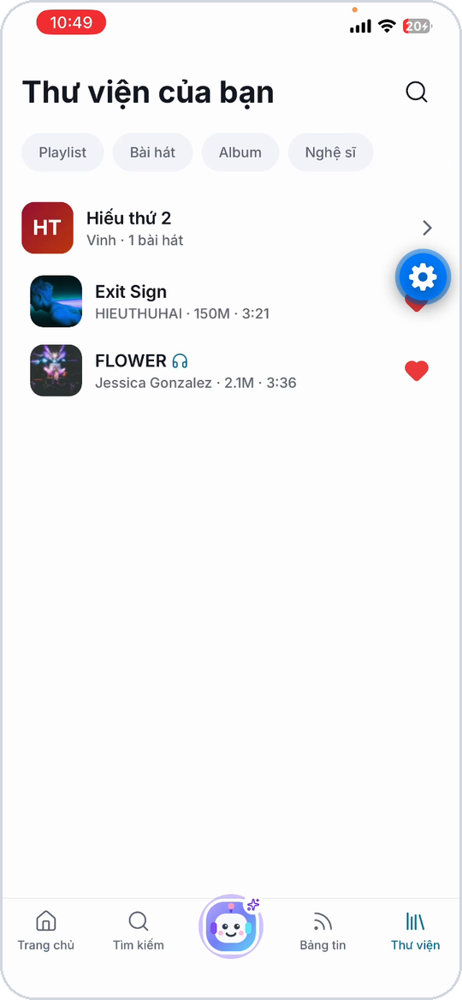
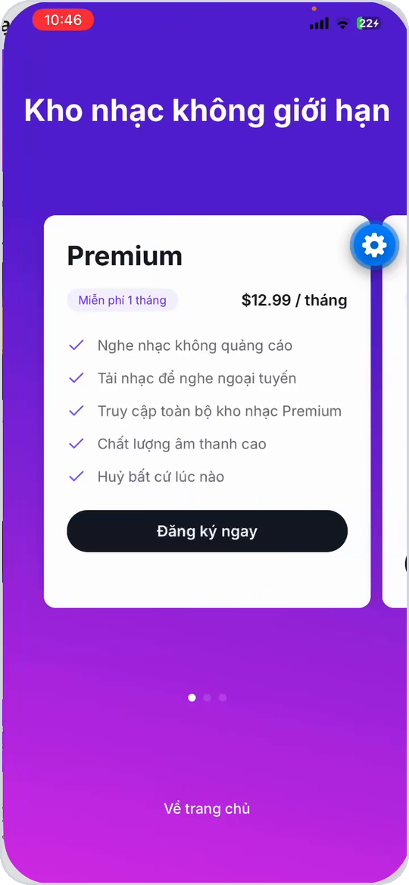
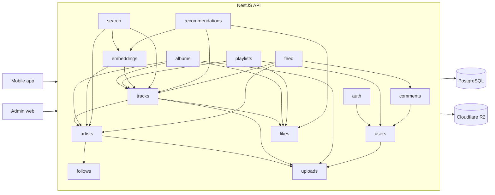
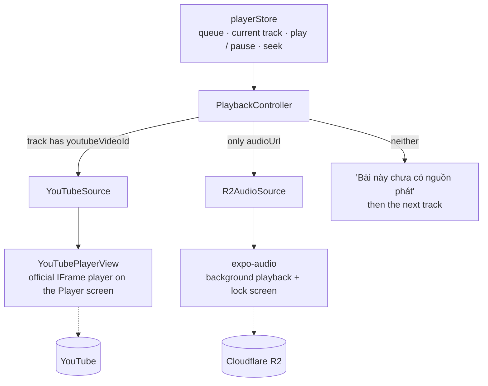

<div align="center">

# 🎵 Music Stream

**A cross-platform music streaming app built with Expo, React Native and TypeScript.**

Final project for the **Mobile Programming** course — Industrial University of Ho Chi Minh City (IUH)


[](https://github.com/vinhmai2109551/music-stream-app/actions/workflows/ci.yml)

</div>

---

## Table of Contents

- [🎵 Music Stream](#-music-stream)
  - [Table of Contents](#table-of-contents)
  - [Overview](#overview)
  - [Screens \& Features](#screens--features)
  - [Screenshots](#screenshots)
  - [Tech Stack](#tech-stack)
  - [Project Structure](#project-structure)
  - [Getting Started](#getting-started)
    - [Prerequisites](#prerequisites)
    - [Installation](#installation)
    - [Run on a device](#run-on-a-device)
  - [Backend](#backend)
  - [Playback architecture](#playback-architecture)
  - [Release builds (EAS)](#release-builds-eas)
  - [Known limitations](#known-limitations)
  - [Testing and CI](#testing-and-ci)
  - [Available Scripts](#available-scripts)
  - [Branching Workflow](#branching-workflow)
  - [Project Management](#project-management)
  - [Author](#author)
  - [License](#license)

## Overview

**Music Stream** is a mobile music streaming application that lets users discover music, follow artists, browse albums and playlists, play tracks with a full-featured player, and manage a personal library. It is developed as a final project for the Mobile Programming course at IUH, with a focus on mobile-first UI, clean architecture and smooth performance on both Android and iOS.

## Screens & Features

The app consists of the 13 screens of the design:

| #   | Screen                 | Key features                                                                                                                 |
| --- | ---------------------- | ---------------------------------------------------------------------------------------------------------------------------- |
| 1   | **Launch**             | Branded welcome screen with the app tagline; leads to login or register (login has a Cloudflare check)                       |
| 2   | **Home**               | Greeting, search entry, region filter, suggestions, charts, trending albums, popular artists                                 |
| 3   | **Playlist Details**   | Track list, like / unlike, play, add a track to one of your playlists (the album and artist pages work the same way)         |
| 4   | **Play an Audio**      | Play / pause, seek, next / previous, shuffle, repeat (off / all / one), like, comments; official YouTube video or audio file |
| 5   | **Artist Profile**     | Bio, follower count, top tracks, albums, follow / unfollow                                                                   |
| 6   | **Search**             | Suggestions while typing, recent searches (add / remove / clear)                                                             |
| 7   | **Search Results**     | Tabs All / Tracks / Albums / Artists                                                                                         |
| 8   | **Feed**               | Posts of tracks shared by artists, endless scrolling, pull to refresh, likes and comment counts                              |
| 9   | **Comments**           | Comments of a track or a post: newest first, endless scrolling, replies (one level), likes, writing                          |
| 10  | **My Library**         | Liked songs, albums, followed artists and a way into the user's playlists                                                    |
| 11  | **My Playlists**       | The user's playlists and a button to create one                                                                              |
| 12  | **Premium Launch**     | Premium offer reached from a banner on Home (hidden once Premium)                                                            |
| 13  | **Subscription Plans** | Three plans and a welcome screen; the purchase is simulated (see [Known limitations](#known-limitations))                    |

**Cross-cutting features**

- Two playback sources: audio files from our own storage (`expo-audio`) and official YouTube videos (embedded player) — see [Playback architecture](#playback-architecture)
- Region filter on Home (Vietnam, K-Pop, J-Pop, C-Pop)
- Persistent library state (likes, follows, playlists, recent searches) via Zustand + AsyncStorage
- Reusable UI kit: `AppText`, `Button`, `Chip`, `IconButton`, `SearchBar`, `BottomSheet`, `Toast`, `Skeleton`, `EmptyState`
- Centralised design tokens (colors, typography, spacing, radius, shadows)
- File-based navigation with Expo Router and typed routes
- Light and dark theme that follows the phone's setting; every text colour reaches WCAG AA contrast in both (checked by a test)
- Sign-in protected by Cloudflare Turnstile, rate limits per endpoint group, and refresh tokens that rotate with a short grace period (see [Behaviour worth knowing](#behaviour-worth-knowing))
- Plays are counted once per user and track in a time window; comments are read page by page
- Tested: Jest unit and component tests for the app, Jest end-to-end tests for the API against a real PostgreSQL, and a GitHub Actions workflow that runs them (see [Testing and CI](#testing-and-ci))

> **Note:** The 13 screens are in place (Launch, Home, Playlist / Album / Artist details, Player, Search with results, Feed with comments, Library, My Playlists, Premium launch and plans). Remaining work is tracked in [Project Management](#project-management).

## Screenshots

The images are screenshots of the running app. The files to capture, what each one must show and the size to use are listed in [`docs/screenshots/README.md`](docs/screenshots/README.md); put them in `docs/screenshots/` with exactly these names.

|                 Launch                 |                Login                 |                Home                |                     Home (dark)                      |
| :------------------------------------: | :----------------------------------: | :--------------------------------: | :--------------------------------------------------: |
|  |  |  |  |

|                  Playlist                  |                 Player                 |                 Artist                 |                 Search                 |
| :----------------------------------------: | :------------------------------------: | :------------------------------------: | :------------------------------------: |
|  |  |  |  |

|                     Search results                     |                Feed                |                  Comments                  |                 Library                  |
| :----------------------------------------------------: | :--------------------------------: | :----------------------------------------: | :--------------------------------------: |
|  |  |  |  |

|                    My playlists                    |                 Premium                  |                     Welcome to Premium                      |
| :------------------------------------------------: | :--------------------------------------: | :---------------------------------------------------------: |
|  |  |  |

## Tech Stack

| Area         | Technology                                                                                           |
| ------------ | ---------------------------------------------------------------------------------------------------- |
| Framework    | [Expo](https://expo.dev) SDK 58, React Native 0.88, React 19                                         |
| Language     | TypeScript                                                                                           |
| Navigation   | Expo Router (file-based, typed routes)                                                               |
| State        | Zustand with `persist` middleware                                                                    |
| Storage      | `@react-native-async-storage/async-storage`                                                          |
| Audio        | `expo-audio` (files from R2), `react-native-youtube-iframe` + `react-native-webview` (YouTube)       |
| Animation    | React Native Reanimated, Gesture Handler, Worklets                                                   |
| UI & visuals | `expo-image`, `expo-linear-gradient`, `expo-blur`, `lucide-react-native`, `react-native-svg`         |
| Typography   | Inter via `@expo-google-fonts/inter`                                                                 |
| Code quality | ESLint (`eslint-config-expo`), Prettier, `tsc`                                                       |
| Testing      | Jest (`jest-expo`) and React Native Testing Library for the app; Jest and supertest for the API      |
| Backend      | NestJS 12 (ESM), Prisma 7, PostgreSQL 16, Cloudflare R2 for files                                    |
| Security     | Cloudflare Turnstile on login, `@nestjs/throttler` rate limits, JWT access + rotating refresh tokens |
| Build & CI   | GitHub Actions (`.github/workflows/ci.yml`), EAS Build (`mobile/eas.json`)                           |

## Project Structure

```text
music-stream-app/
├── mobile/                  # Expo app (this is what runs on the phone)
│   ├── assets/images/       # App icons, covers, artists, feed and onboarding art
│   ├── src/
│   │   ├── app/             # Expo Router routes (each file is a screen)
│   │   ├── components/      # ui/ (base components) and media/ (track rows, player, ...)
│   │   ├── constants/       # App-wide constants and copy
│   │   ├── data/            # Catalog, images and mock data
│   │   ├── hooks/           # Custom hooks (fonts, toast, audio engine, ...)
│   │   ├── __tests__/       # Jest tests, mocks and helpers (not part of the routes)
│   │   ├── store/           # Zustand stores (player, library)
│   │   ├── theme/           # Design tokens
│   │   ├── types/           # Shared TypeScript types
│   │   └── utils/           # Helpers (formatTime, formatCount, ...)
│   ├── .env.example         # Copy to .env and fill in
│   ├── app.json             # Expo configuration (name, ids, version, theme)
│   ├── eas.json             # EAS Build profiles: development, preview, production
│   └── package.json
├── backend/                 # NestJS API: modular monolith + Prisma + PostgreSQL
├── docker-compose.yml       # PostgreSQL + API (with a healthcheck)
├── docs/screenshots/        # Screenshots used by this README
├── .github/workflows/       # CI
├── frontend/                # Admin web app (planned)
└── README.md
```

Each part has its own `package.json` and `package-lock.json` (no npm workspaces), so install and run commands are executed inside the part's folder.

## Getting Started

### Prerequisites

- [Node.js](https://nodejs.org) (LTS)
- npm
- [Expo Go](https://expo.dev/go) installed on your Android or iOS device (the phone and computer must be on the same network)

### Installation

```bash
# 1. Clone the repository
git clone https://github.com/vinhmai2109551/music-stream-app.git
cd music-stream-app/mobile

# 2. Install dependencies
npm install

# 3. Create your local environment file
cp .env.example .env

# 4. Start the development server
npx expo start
```

### Run on a device

1. Run `npx expo start` inside the `mobile/` folder.
2. Open **Expo Go** on your phone.
   - **Android:** scan the QR code from within Expo Go.
   - **iOS:** scan the QR code with the Camera app.
3. The app loads and hot-reloads as you edit the code.

Alternatively, press `a` (Android emulator), `i` (iOS simulator) or `w` (web) in the terminal.

## Backend

The API is a **modular monolith**: one deployable NestJS app, one PostgreSQL database, but every
domain is a self-contained module that owns its tables and exposes a small public API.



- An arrow means "uses the public API of" (`modules/<name>/index.ts`). The graph has no cycles.
- ESLint rejects imports that reach into another module's internals.
- Run it with Docker (applies the migrations on start; loads the demo data when `SEED_ON_START=true`, see below):

```bash
cp backend/.env.example backend/.env   # then edit the secrets
docker compose up -d --build
```

API: `http://localhost:3000/api` · Swagger: `http://localhost:3000/api/docs` · health: `http://localhost:3000/api/health`.

`backend/.env.example` ships `SEED_ON_START=false`, which is what production wants: with `true` every start overwrites the demo artists, tracks and playlists with the versions in the code and recreates the admin account. For a first run (or development) set it to `true`: the demo catalog and the admin account (`SEED_ADMIN_EMAIL` / `SEED_ADMIN_PASSWORD` from `backend/.env`) are created, then set it back to `false`.

`GET /api/health` answers `200 { status: "ok", database: "up" }` when the API reaches its database and `503 { status: "error", database: "down" }` otherwise (no login, not rate limited). The `api` service of `docker-compose.yml` uses it as its healthcheck (`docker compose ps` shows `healthy`); on a hosting platform point the health check path at it.

Without Docker for the API (database still in Docker): `docker compose up -d db`, then in `backend/`:
`npm install`, `npm run prisma:migrate`, `npm run prisma:seed`, `npm run start:dev`.

**The database image is `pgvector/pgvector:pg16`** (PostgreSQL 16 plus the `vector` extension that semantic search uses; CI uses the same image). The first migration of this feature runs `CREATE EXTENSION vector`, so a host that does not ship pgvector cannot run it. If you already have a volume made by the older `postgres:16-alpine` image, the data is kept (same major version, same volume), but that image was Alpine and this one is Debian, whose text sorting differs, so rebuild the indexes once after switching:

```bash
docker compose pull db && docker compose up -d db
docker compose exec db sh -c 'psql -U "$POSTGRES_USER" -d "$POSTGRES_DB" -c "REINDEX DATABASE $POSTGRES_DB"'
cd backend && npm run prisma:deploy     # applies the pgvector migration
```

(Back up first if the data matters: `docker compose exec db sh -c 'pg_dump -U "$POSTGRES_USER" -Fc "$POSTGRES_DB"' > backup.dump`.) A fresh volume needs none of this.

**Text embeddings** (used by the semantic features that follow) need `EMBEDDING_PROVIDER=gemini` and an `EMBEDDING_API_KEY` in `backend/.env` (a key from [Google AI Studio](https://aistudio.google.com/apikey); the model is `gemini-embedding-2`, 768-number vectors). Without them those features answer `503` and are hidden in the app; everything else works. `EMBEDDING_PROVIDER=fake` is a deterministic offline stand-in for development and tests, refused in production. A new or edited track or artist gets its vector in the background; to catch up on everything (after the first seed, after `npm run ai:enrich`, or when the model changes) run `npm run ai:embed` in `backend/` (`-- --force` makes every vector again). It only does the work that is left, 64 texts at a time, waits out rate limits, and is safe to run again. Content sent through Google's free tier may be used by Google to improve its products.

**Help texts for the assistant** live in `backend/src/modules/ai/knowledge/*.md` (what the app does and does not do; edit them like any document). `npm run ai:embed` also cuts them into chunks of about 500 characters (50 overlap, never across a heading), stores one vector per chunk in `KnowledgeChunk` and, on the next run, remakes only the chunks whose text changed. `KNOWLEDGE_DIR` points to another folder. Write only what is true of the app: the assistant quotes these files as its answer.

**The AI assistant** (`backend/src/modules/ai`) is a chat with a language model (Gemini through the Interactions API, behind a provider-neutral `LlmClient`). It needs `GEMINI_API_KEY` (or `EMBEDDING_API_KEY`, one Google AI Studio key does both); without a key every `/api/ai/*` endpoint answers `503` and the app hides the feature. The key stays on the server.

| Endpoint | What it does |
| --- | --- |
| `POST /api/ai/conversations` | New conversation (an empty one is given again; at most 50 per user, then `409`) |
| `GET /api/ai/conversations` | The user's conversations, most recently used first |
| `GET /api/ai/conversations/:id/messages` | What was said (the latest 500) |
| `DELETE /api/ai/conversations/:id` | Deletes it (`409` while an answer is being written) |
| `POST /api/ai/conversations/:id/messages` | Sends `{ text }` (1 to 2000 characters) and streams the answer as Server-Sent Events |
| `GET /api/ai/usage` | `{ used, limit }` of today |

The answer is `text/event-stream`: `text_delta` `{ text }` pieces, then `done` `{ messageId, truncated }` or `error` `{ code, message }`. Anything that can be refused is an ordinary JSON error before the stream starts: `404` (not your conversation), `409` (the previous answer is still being written), `429` (more than 12 messages a minute, or the daily limit of `AI_DAILY_MESSAGE_LIMIT`, 30, counted per day of Vietnam time in its own table so that deleting a conversation gives nothing back), `503`. A rate limit of the model is retried once, then shown as "Trợ lý đang quá tải, thử lại sau ít phút"; a failed or cancelled answer is not kept and not counted. Closing the connection cancels the request to the model. Only the last 20 messages go to the model. `AI_PROVIDER=fake` is an echo for tests and offline development (refused in production). The "an answer is being written" lock is in memory, which is right for one API instance; behind several, make it a database lock first.

**What the assistant can do (tools).** The model never touches data itself: it asks the server to run a tool, at most 6 per message, and the server checks every argument and acts only for the signed-in user.

| Tool | Kind | What it does |
| --- | --- | --- |
| `search_catalog` | read | Hybrid search (words + meaning) of tracks, artists, albums or playlists |
| `get_track`, `get_artist`, `get_album`, `get_playlist` | read | Details; a playlist is an editorial one or the user's own |
| `get_my_library` | read | Liked tracks, followed artists, the user's playlists with their ids |
| `recommend_tracks`, `similar_tracks` | read | Personal and similar tracks (see Recommendations) |
| `search_help` | read | Looks up the help texts and returns the source to cite |
| `play_tracks` | app | Sends the app a `client_action` event (up to 50 tracks); changes nothing |
| `create_playlist`, `add_tracks_to_playlist`, `like_tracks`, `follow_artist` | change | Only **proposed**: the server stores a pending action (10 minutes), sends `action_required` and ends the stream; nothing happens until `POST /api/ai/actions/:id/confirm` |

`/reject` turns it down. Both answers stream the rest of the assistant's reply, like a message does (`tool_result` first). They count as one message of the daily limit (at the limit a confirmed change is still made and reported, without a model reply) and the 12 per minute limit, counted per endpoint. A proposal is valid for the person who got it (`404` for anyone else), once (`409`), and for 10 minutes (`410`); writing a new message instead ends it. Only one change is proposed per round, only to the user's **own** playlists (an admin's assistant too), at most 50 tracks per call. SSE events: `text_delta`, `tool_call`, `tool_result` (with the `display` cards), `action_required`, `client_action`, `done` (`awaitingAction`), `error`.


**Measuring the search.** `npm run ai:eval` (in `backend/`, after `prisma:seed` and `ai:embed`) runs the ~30 Vietnamese and English questions of `backend/eval/search-queries.json` (each with the tracks a person accepts as a good answer) through the search by words, the search by meaning and the two merged, prints Recall@10, MRR@10 and nDCG@10 for each, and writes `backend/eval/results.md` (per kind of query and per query, and the queries where merging is worse than the better list). It refuses to run with the offline `fake` provider (its numbers would say nothing about meaning), with tracks that have no vector, or with a track id that is not in the database. The labels were chosen from titles, artists, languages and the catalog metadata, which is also the text of the vectors, so mood questions favour the vector search a little.

### Behaviour worth knowing

All settings below are optional environment variables with the defaults shown (see `backend/.env.example`).

| Topic                      | Behaviour                                                                                                                                                                                                                                                                                                                                                                          | Settings                                                                                                                          |
| -------------------------- | ---------------------------------------------------------------------------------------------------------------------------------------------------------------------------------------------------------------------------------------------------------------------------------------------------------------------------------------------------------------------------------- | --------------------------------------------------------------------------------------------------------------------------------- |
| **Rate limits**            | Three independent groups, counted per IP (play: per user): login + register `5/min` (each call can be a password guess), refresh `30/min` (a healthy app refreshes by itself), `POST /tracks/:id/play` `60/min`. Over the limit: `429`.                                                                                                                                            | `AUTH_THROTTLE_*`, `REFRESH_THROTTLE_*`, `PLAY_THROTTLE_*` (`LIMIT`, `TTL_SECONDS`)                                               |
| **Cloudflare Turnstile**   | `POST /auth/login` needs a `turnstileToken` from the Turnstile widget on the login screen (a WebView on iOS / Android, Cloudflare's script on web). The server checks it with Siteverify before comparing the password: missing or failed `400`, Cloudflare unreachable `503`. Without a secret key the check is skipped (development only; production refuses to start).          | `TURNSTILE_SECRET_KEY`, `TURNSTILE_ALLOWED_HOSTNAMES`; mobile: `EXPO_PUBLIC_TURNSTILE_SITE_KEY`, `EXPO_PUBLIC_TURNSTILE_HOSTNAME` |
| **Reverse proxy**          | `TRUST_PROXY=1` makes Express read the visitor's IP from the proxy's `X-Forwarded-For`, so the limits count real visitors behind Railway / Render. Use `0` / `false` when the API is reachable directly, otherwise a client could write that header itself and dodge the limit.                                                                                                    | `TRUST_PROXY` (`1`)                                                                                                               |
| **Counting plays**         | `POST /tracks/:id/play` needs a login. The same user replaying the same track within the window answers `200 { plays, counted: false }` and changes nothing. Each counted listen is a `PlayEvent` row (also the base of a future "recently played" list). An unknown track is `404`.                                                                                               | `PLAY_DEDUPE_MINUTES` (`30`)                                                                                                      |
| **Tracks without a file**  | `audioUrl` is optional (`null`). Commercial tracks only have a `youtubeVideoId`; the seed fills `audioUrl` just for the original demo tracks that are in the bucket. A track must have at least one of the two, or creating / updating it is `400`.                                                                                                                                |                                                                                                                                   |
| **Comments**               | `GET /comments?trackId=` (or `postId=`) returns top-level comments, newest first, with `cursor` / `limit` (20, max 50): `{ items, nextCursor, total }`. Each comment carries its 3 newest replies (oldest first) and `repliesCount`; `GET /comments/:id/replies?cursor=&limit=` loads older ones. Replies are one level deep: answering a reply attaches to the top-level comment. |                                                                                                                                   |
| **Refresh token rotation** | Every refresh replaces the token. Presenting a replaced token again is treated as theft and revokes the whole login (`401`), **except** during the grace period: the app may have been killed before it saved the new token, so a token replaced less than 10 s ago gets another new token of the same login.                                                                      | `REFRESH_REUSE_GRACE_SECONDS` (`10`; `0` turns it off)                                                                            |

## Playback architecture

Every track can carry two places to play from: `youtubeVideoId` (the official video, from the artist's own channel) and `audioUrl` (an audio file in our Cloudflare R2 bucket). The player picks one **per track**, and never plays anything else in its place.



- `playerStore` is the source of truth (queue, shuffle, repeat, position). `PlaybackController` applies it to the source that fits the track and reports position, duration and errors back.
- Both sources implement the same `PlaybackSource` interface (`load`, `play`, `pause`, `seekTo`, `getPosition`, `getDuration`, `onEnded`, `onError`), so queue, next / previous, shuffle and repeat work the same for a queue that mixes them.
- A YouTube track shows the official player in place of the cover on the Player screen (square, at least 200 × 200, never covered). The seek bar and buttons are the app's own; the position is read from the player every 500 ms.
- When a track cannot be played:

| Situation                                                        | What happens                                                                                                                                                 |
| ---------------------------------------------------------------- | ------------------------------------------------------------------------------------------------------------------------------------------------------------ |
| YouTube refuses the embed (error 101 / 150) or the video is gone | Toast "Bài này không phát được trong app", button "Mở trên YouTube"; if the track has an R2 file it plays that instead, otherwise the player skips after 3 s |
| Offline / the load never finishes                                | Error with a "Thử lại" button                                                                                                                                |
| No `youtubeVideoId` and the R2 file is missing (404)             | "Bài này chưa có nguồn phát", then the next track. No substitute audio is played                                                                             |

**Why two sources.** Music we do not own is never downloaded, extracted or re-streamed: it is played only through YouTube's official embedded player, which keeps the ads, attribution and rights-holder control that YouTube's terms require (so the player must stay visible and unobscured). The R2 bucket holds only audio we have the right to host (original or licensed demo tracks), which is what allows background playback and lock screen controls.

**Why YouTube tracks stop in the background.** YouTube's terms allow a video to be played only in its official embedded player, which must stay visible (at least 200 × 200, not covered, no audio-only mode, no hidden player), and the app may not extract the audio. That player is a web page inside a WebView, and iOS and Android suspend a WebView when the app leaves the screen, so the video cannot keep playing; the app pauses it and, once per session, says so when the user comes back. Audio files from R2 are played by `expo-audio`, which is allowed to run in the background and shows lock screen controls.

**Music that does play in the background.** The playlist **Phát nền – Background** has 8 tracks by Kevin MacLeod (CC BY) hosted in R2, without a YouTube video. Tracks like these are marked with a headphones badge in lists and on the player. Their sources, licences and the files to upload are in [`backend/src/seed/LICENSED_AUDIO.md`](backend/src/seed/LICENSED_AUDIO.md).

**The YouTube player page is ours.** The WebView loads `GET /api/embed/youtube-player` from the backend (the app passes it as `baseUrlOverride`), not a page from the library author's GitHub Pages. It speaks the protocol of `react-native-youtube-iframe` (play, pause, mute, volume, rate, `player.getCurrentTime()`, `seekTo`, state and error events), fills the square frame, and is served with a Content-Security-Policy that allows only `youtube.com` and `ytimg.com` and names its own script by hash. YouTube refuses embeds that send no referrer, so the page keeps `Referrer-Policy: strict-origin-when-cross-origin`. Use an **https** API address in release builds.

## Release builds (EAS)

The app id is `com.vinhmai.musicstream` on both platforms (`app.json`); `version` is the number users see, `android.versionCode` / the iOS build number are raised by EAS on every production build (`autoIncrement`). The app follows the phone's light / dark setting (`userInterfaceStyle: "automatic"`).

`mobile/eas.json` has three profiles; all of them read the API address and the other `EXPO_PUBLIC_*` values from the `env` of `eas.json`, because `mobile/.env` is not part of a cloud build:

| Profile       | What it builds                                                       | API address (`EXPO_PUBLIC_API_URL`)                              |
| ------------- | -------------------------------------------------------------------- | ---------------------------------------------------------------- |
| `development` | A development client for your own phone (internal distribution)      | your computer, `http://192.168.1.x:3000/api`                     |
| `preview`     | An **APK** you can install on any Android phone and send to testers  | the deployed backend, `https://music-stream-api.example.com/api` |
| `production`  | A store build (AAB on Android, IPA on iOS), build number auto-raised | the deployed backend (same placeholder)                          |

**Before the first build, fill in `eas.json`:**

1. `EXPO_PUBLIC_API_URL`: the address of your deployed backend, **https**, ending in `/api` (a release build refuses plain `http`; the player page and every request go through it).
2. `EXPO_PUBLIC_MEDIA_BASE_URL`: the public address of the R2 bucket.
3. `EXPO_PUBLIC_TURNSTILE_SITE_KEY` and `EXPO_PUBLIC_TURNSTILE_HOSTNAME`: your Cloudflare Turnstile widget (the placeholder test key only works with the test secret key). Add the hostname to the widget on Cloudflare and, if you set it, to `TURNSTILE_ALLOWED_HOSTNAMES` of the backend.
4. The `development` profile needs `expo-dev-client` (`npx expo install expo-dev-client`), which is not installed yet.

**Build** (needs an Expo account; nothing here is done for you):

```bash
npm install --global eas-cli
cd mobile
eas login
eas init                                        # links the project, writes extra.eas.projectId into app.json
eas build --platform android --profile preview  # APK, the link appears when the build ends
eas build --platform all --profile production   # store builds (asks for Apple / Google credentials)
```

The backend must be deployed first (any host that runs the Docker image or `npm run build && npm run start` and has a PostgreSQL database). Set its environment as in `backend/.env.example`: with `NODE_ENV=production` it refuses to start without the R2 settings and `TURNSTILE_SECRET_KEY`, and set `TRUST_PROXY` to the number of proxies in front of it.

## Known limitations

- **YouTube tracks do not play with the screen off.** The embedded player has to stay visible, so closing the Player screen does not stop the video: it moves into a floating 200 × 200 card above the mini player (YouTube's minimum size; its × stops playback). The track pauses when the app goes to the background. Audio files from R2 keep playing with the screen off (see the playlist **Phát nền – Background**).
- **Premium is simulated.** "Subscribe now" only sets the account's `isPremium` flag on the server (`POST /users/me/subscribe`); there is no payment, no billing period and no way to cancel.
- **Commercial music plays only through YouTube's official embed.** The app never downloads, extracts or re-streams it, so those tracks have no `audioUrl`; the only audio hosted by us is music we may host (the original demo tracks and the Creative Commons playlist).
- **No lock screen / notification controls for YouTube tracks** (the video is not an audio session of the app).
- **Ads can appear** on YouTube tracks; they are shown by YouTube and cannot be skipped by the app.
- **The floating card covers part of the screen** while a YouTube track is current. The player lives above all screens (`YouTubeHost`), so the Player screen is a normal pushed screen, not a native modal (a native modal would hide the video on iOS).
- **Lock screen buttons of R2 tracks:** play / pause and ±15 s. Next / previous are not offered because `expo-audio` only provides them for its native playlist, not for a single player.
- **Expo Go:** background audio on iOS is part of Expo Go; on Android, the foreground service and lock screen controls come from the `expo-audio` config plugin in `app.json`, which Expo Go does not apply. If they do not show up on an Android phone, use a development build (`npx expo run:android` or EAS Build).
- **Pictures of the new catalog are video pictures.** Artists, albums, regional playlists and songs show the picture YouTube makes of their official videos (nothing is hosted by us, so nothing has to be uploaded); the choice is in `backend/src/seed/catalog/pictures.ts`. They are video frames, not portraits, and a video that is removed loses its picture (the app then shows a coloured tile with initials). Only the Background playlist (Kevin MacLeod) and the original demo data have pictures in R2.
- **Search by words ignores accents** (`son tung` finds `Sơn Tùng`) through a normalized `searchName` column kept in step by the API; a row changed by hand in SQL keeps its old `searchName` until it is renamed through the API. The match is a substring match without a trigram index, which is fine at this catalog size.
- **Recommendations** (`GET /api/recommendations/for-you`, `/recommendations/because-you-listened`, `/tracks/:id/similar`) build a taste vector from the vectors of the tracks a user liked (weight 3) and played in the last 30 days (fading), skip what they already know, and pick a varied list (MMR, at most three tracks per artist). A user with no history gets the most played tracks. `similar` and `because-you-listened` answer `503` without embeddings and the app then hides those sections.
- **Search by meaning** (`GET /api/search/semantic?q=nhạc buồn ngày mưa`) merges the search by words with the nearest vectors (reciprocal rank fusion). It needs the embeddings above; without a provider it answers `503`, and when the provider fails at that moment it answers with the search by words alone and `degraded: true`. There is no similarity cutoff yet, so a question matching nothing still returns the nearest tracks.
- Some videos forbid embedding; they fall back to the R2 file or are reported as above.

## Testing and CI

| Where      | Command                  | What it runs                                                                                                                                                                      |
| ---------- | ------------------------ | --------------------------------------------------------------------------------------------------------------------------------------------------------------------------------- |
| `mobile/`  | `npm test`               | Jest unit and component tests (the player, the API client, the stores, helpers, the track row, the login screen, the theme)                                                       |
| `mobile/`  | `npm test -- --coverage` | The same with a coverage table for `src/utils` and `src/store` (the build fails under 80%; it is about 96% today)                                                                 |
| `backend/` | `npm test`               | Unit tests of the configuration, pagination, Turnstile, health and the other small pieces                                                                                         |
| `backend/` | `npm run test:e2e`       | Builds the API, then runs end-to-end specs against a real PostgreSQL (needs `docker compose up -d db`; it creates its own `*_e2e` database and never touches the development one) |

Every push and pull request into `main` and `dev` runs [`.github/workflows/ci.yml`](.github/workflows/ci.yml): two jobs in parallel, **Backend** (Prisma generate and migrate on a PostgreSQL service, lint, types, unit and e2e tests) and **Mobile** (lint, types, tests with coverage). npm downloads are cached per `package-lock.json`.

## Available Scripts

Run these from the `mobile/` folder.

| Script               | Command                | Description                         |
| -------------------- | ---------------------- | ----------------------------------- |
| `npm start`          | `expo start`           | Start the development server        |
| `npm run android`    | `expo start --android` | Start and open on Android           |
| `npm run ios`        | `expo start --ios`     | Start and open on iOS               |
| `npm run web`        | `expo start --web`     | Start and open in the browser       |
| `npm run typecheck`  | `tsc --noEmit`         | Type-check the project              |
| `npm run lint`       | `expo lint`            | Lint the source code                |
| `npm run lint:fix`   | `expo lint --fix`      | Lint and auto-fix issues            |
| `npm run format`     | `prettier --write .`   | Format all files with Prettier      |
| `npm test`           | `jest`                 | Run the tests                       |
| `npm run test:watch` | `jest --watch`         | Run the tests again on every change |

Run `npm run typecheck`, `npm run lint` and `npm test` before opening a pull request. The scripts of `backend/` (`start:dev`, `typecheck`, `lint`, `test`, `test:e2e`, `prisma:migrate`, `prisma:seed`) are listed in [Backend](#backend).

## Branching Workflow

Development follows a three-tier flow:

```text
Vinh  ──►  dev  ──►  main
(feature)  (integration)  (stable)
```

- **`Vinh`** — personal working branch where all features and fixes are developed.
- **`dev`** — integration branch; `Vinh` is merged here through a pull request after review.
- **`main`** — stable branch; only tested code from `dev` is merged here.

Commit messages follow [Conventional Commits](https://www.conventionalcommits.org) and reference the Jira issue key, for example:

```text
feat(foundation): add theme tokens, types, mock data, stores and base UI [SAM1-24]
```

## Project Management

Tasks, epics and progress are tracked in **Jira** under project key **`SAM1`**. Every commit and pull request references its Jira issue (e.g. `SAM1-13`) for traceability.

## Author

| Field      | Details                                         |
| ---------- | ----------------------------------------------- |
| **Name**   | Mai Lưu Hữu Vinh                                |
| **Class**  | DHKTPM19BTT                                     |
| **School** | Industrial University of Ho Chi Minh City (IUH) |

## License

This project is licensed under the terms of the [LICENSE](LICENSE) file.
