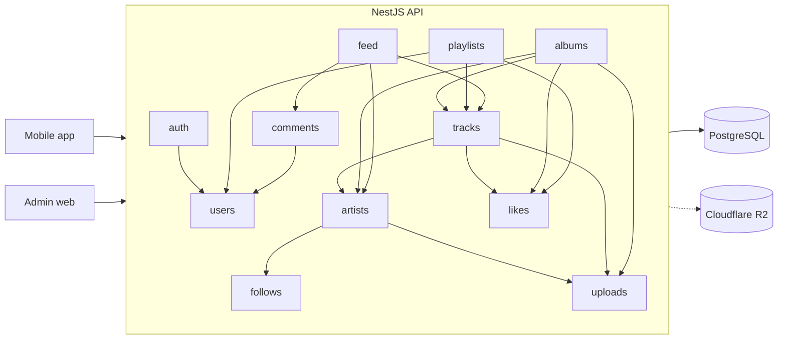
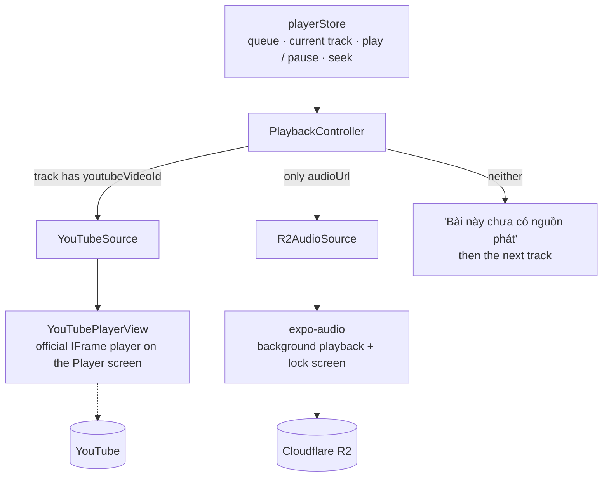

<div align="center">

# 🎵 Music Stream

**A cross-platform music streaming app built with Expo, React Native and TypeScript.**

Final project for the **Mobile Programming** course — Industrial University of Ho Chi Minh City (IUH)


</div>

---

## Table of Contents

- [🎵 Music Stream](#-music-stream)
  - [Table of Contents](#table-of-contents)
  - [Overview](#overview)
  - [Screens \& Features](#screens--features)
  - [Screenshots](#screenshots)
  - [Tech Stack](#tech-stack)
  - [Project Structure](#project-structure)
  - [Getting Started](#getting-started)
    - [Prerequisites](#prerequisites)
    - [Installation](#installation)
    - [Run on a device](#run-on-a-device)
  - [Backend](#backend)
  - [Playback architecture](#playback-architecture)
  - [Known limitations](#known-limitations)
  - [Available Scripts](#available-scripts)
  - [Branching Workflow](#branching-workflow)
  - [Project Management](#project-management)
  - [Author](#author)
  - [License](#license)

## Overview

**Music Stream** is a mobile music streaming application that lets users discover music, follow artists, browse albums and playlists, play tracks with a full-featured player, and manage a personal library. It is developed as a final project for the Mobile Programming course at IUH, with a focus on mobile-first UI, clean architecture and smooth performance on both Android and iOS.

## Screens & Features

The app consists of 13 screens:

| #   | Screen              | Key features                                                                     |
| --- | ------------------- | -------------------------------------------------------------------------------- |
| 1   | **Launch**          | Branded welcome screen with the app tagline and call-to-action                   |
| 2   | **Premium**         | Subscription offer; unlocks premium state (persisted locally)                    |
| 3   | **Home**            | Greeting, search entry, suggestions, popular artists, albums and playlists       |
| 4   | **Search**          | Search tracks/artists, recent searches (add / remove / clear), browse categories |
| 5   | **Feed**            | Social feed of tracks shared by artists, with likes and comment counts           |
| 6   | **Comments**        | Threaded comments and replies on a feed post                                     |
| 7   | **Library**         | Liked tracks, liked albums/playlists, followed artists, user-created playlists   |
| 8   | **Playlist Detail** | Track list, like/unlike playlist, play/shuffle, rename and delete                |
| 9   | **Album Detail**    | Album tracks, like/unlike album, play all                                        |
| 10  | **Artist Profile**  | Bio, follower count, top tracks, albums, follow/unfollow                         |
| 11  | **Player**          | Play/pause, seek, next/previous, shuffle, repeat (off / all / one), like         |
| 12  | **Create Playlist** | Create a new playlist and add or remove tracks                                   |
| 13  | **Add to Playlist** | Bottom sheet to save a track into one of the user's playlists                    |

**Cross-cutting features**

- Two playback sources: audio files from our own storage (`expo-audio`) and official YouTube videos (embedded player) — see [Playback architecture](#playback-architecture)
- Region filter on Home (Vietnam, K-Pop, J-Pop, C-Pop)
- Persistent library state (likes, follows, playlists, recent searches) via Zustand + AsyncStorage
- Reusable UI kit: `AppText`, `Button`, `Chip`, `IconButton`, `SearchBar`, `BottomSheet`, `Toast`, `Skeleton`, `EmptyState`
- Centralised design tokens (colors, typography, spacing, radius, shadows)
- File-based navigation with Expo Router and typed routes

> **Note:** The 13 screens are in place (Launch, Home, Playlist / Album / Artist details, Player, Search with results, Feed with comments, Library, My Playlists, Premium launch and plans). Remaining work is tracked in [Project Management](#project-management).

## Screenshots

> Screenshots will be added as screens are completed. Place images in `docs/screenshots/` and update the table below.

|                 Launch                 |                Home                |                 Search                 |
| :------------------------------------: | :--------------------------------: | :------------------------------------: |
|  |  |  |

|                 Player                 |                 Library                  |                 Artist                 |
| :------------------------------------: | :--------------------------------------: | :------------------------------------: |
|  |  |  |

## Tech Stack

| Area         | Technology                                                                                     |
| ------------ | ---------------------------------------------------------------------------------------------- |
| Framework    | [Expo](https://expo.dev) SDK 58, React Native 0.88, React 19                                   |
| Language     | TypeScript                                                                                     |
| Navigation   | Expo Router (file-based, typed routes)                                                         |
| State        | Zustand with `persist` middleware                                                              |
| Storage      | `@react-native-async-storage/async-storage`                                                    |
| Audio        | `expo-audio` (files from R2), `react-native-youtube-iframe` + `react-native-webview` (YouTube) |
| Animation    | React Native Reanimated, Gesture Handler, Worklets                                             |
| UI & visuals | `expo-image`, `expo-linear-gradient`, `expo-blur`, `lucide-react-native`, `react-native-svg`   |
| Typography   | Inter via `@expo-google-fonts/inter`                                                           |
| Code quality | ESLint (`eslint-config-expo`), Prettier, `tsc`                                                 |

## Project Structure

```text
music-stream-app/
├── mobile/                  # Expo app (this is what runs on the phone)
│   ├── assets/images/       # App icons, covers, artists, feed and onboarding art
│   ├── src/
│   │   ├── app/             # Expo Router routes (each file is a screen)
│   │   ├── components/      # ui/ (base components) and media/ (track rows, player, ...)
│   │   ├── constants/       # App-wide constants and copy
│   │   ├── data/            # Catalog, images and mock data
│   │   ├── hooks/           # Custom hooks (fonts, toast, audio engine, ...)
│   │   ├── store/           # Zustand stores (player, library)
│   │   ├── theme/           # Design tokens
│   │   ├── types/           # Shared TypeScript types
│   │   └── utils/           # Helpers (formatTime, formatCount, ...)
│   ├── .env.example         # Copy to .env and fill in
│   ├── app.json             # Expo configuration
│   └── package.json
├── backend/                 # NestJS API: modular monolith + Prisma + PostgreSQL
├── docker-compose.yml       # PostgreSQL + API
├── frontend/                # Admin web app (planned)
└── README.md
```

Each part has its own `package.json` and `package-lock.json` (no npm workspaces), so install and run commands are executed inside the part's folder.

## Getting Started

### Prerequisites

- [Node.js](https://nodejs.org) (LTS)
- npm
- [Expo Go](https://expo.dev/go) installed on your Android or iOS device (the phone and computer must be on the same network)

### Installation

```bash
# 1. Clone the repository
git clone https://github.com/vinhmai2109551/music-stream-app.git
cd music-stream-app/mobile

# 2. Install dependencies
npm install

# 3. Create your local environment file
cp .env.example .env

# 4. Start the development server
npx expo start
```

### Run on a device

1. Run `npx expo start` inside the `mobile/` folder.
2. Open **Expo Go** on your phone.
   - **Android:** scan the QR code from within Expo Go.
   - **iOS:** scan the QR code with the Camera app.
3. The app loads and hot-reloads as you edit the code.

Alternatively, press `a` (Android emulator), `i` (iOS simulator) or `w` (web) in the terminal.

## Backend

The API is a **modular monolith**: one deployable NestJS app, one PostgreSQL database, but every
domain is a self-contained module that owns its tables and exposes a small public API.



- An arrow means "uses the public API of" (`modules/<name>/index.ts`). The graph has no cycles.
- ESLint rejects imports that reach into another module's internals.
- Run it with Docker (applies migrations and seeds the demo data on start):

```bash
cp backend/.env.example backend/.env   # then edit the secrets
docker compose up -d --build
```

API: `http://localhost:3000/api` · Swagger: `http://localhost:3000/api/docs`.
The seeded admin account is `SEED_ADMIN_EMAIL` / `SEED_ADMIN_PASSWORD` from `backend/.env`.

Without Docker for the API (database still in Docker): `docker compose up -d db`, then in `backend/`:
`npm install`, `npm run prisma:migrate`, `npm run prisma:seed`, `npm run start:dev`.

## Playback architecture

Every track can carry two places to play from: `youtubeVideoId` (the official video, from the artist's own channel) and `audioUrl` (an audio file in our Cloudflare R2 bucket). The player picks one **per track**, and never plays anything else in its place.



- `playerStore` is the source of truth (queue, shuffle, repeat, position). `PlaybackController` applies it to the source that fits the track and reports position, duration and errors back.
- Both sources implement the same `PlaybackSource` interface (`load`, `play`, `pause`, `seekTo`, `getPosition`, `getDuration`, `onEnded`, `onError`), so queue, next / previous, shuffle and repeat work the same for a queue that mixes them.
- A YouTube track shows the official player in place of the cover on the Player screen (square, at least 200 × 200, never covered). The seek bar and buttons are the app's own; the position is read from the player every 500 ms.
- When a track cannot be played:

| Situation                                                        | What happens                                                                                                                                                 |
| ---------------------------------------------------------------- | ------------------------------------------------------------------------------------------------------------------------------------------------------------ |
| YouTube refuses the embed (error 101 / 150) or the video is gone | Toast "Bài này không phát được trong app", button "Mở trên YouTube"; if the track has an R2 file it plays that instead, otherwise the player skips after 3 s |
| Offline / the load never finishes                                | Error with a "Thử lại" button                                                                                                                                |
| No `youtubeVideoId` and the R2 file is missing (404)             | "Bài này chưa có nguồn phát", then the next track. No substitute audio is played                                                                             |

**Why two sources.** Music we do not own is never downloaded, extracted or re-streamed: it is played only through YouTube's official embedded player, which keeps the ads, attribution and rights-holder control that YouTube's terms require (so the player must stay visible and unobscured). The R2 bucket holds only audio we have the right to host (original or licensed demo tracks), which is what allows background playback and lock screen controls.

## Known limitations

- **YouTube tracks do not play with the screen off.** The embedded player has to stay visible, so closing the Player screen does not stop the video: it moves into a floating 200 × 200 card above the mini player (YouTube's minimum size; its × stops playback). The track pauses when the app goes to the background. Audio files from R2 keep playing with the screen off.
- **No lock screen / notification controls for YouTube tracks** (the video is not an audio session of the app).
- **Ads can appear** on YouTube tracks; they are shown by YouTube and cannot be skipped by the app.
- **The floating card covers part of the screen** while a YouTube track is current. The player lives above all screens (`YouTubeHost`), so the Player screen is a normal pushed screen, not a native modal (a native modal would hide the video on iOS).
- **Lock screen buttons of R2 tracks:** play / pause and ±15 s. Next / previous are not offered because `expo-audio` only provides them for its native playlist, not for a single player.
- **Expo Go:** background audio on iOS is part of Expo Go; on Android, the foreground service and lock screen controls come from the `expo-audio` config plugin in `app.json`, which Expo Go does not apply. If they do not show up on an Android phone, use a development build (`npx expo run:android` or EAS Build).
- **The YouTube player page is hosted by the author of `react-native-youtube-iframe`** (GitHub Pages). Its play / pause handler is out of date (it expects plain text while the library sends JSON), so the app injects a small script that fixes it and makes the video fill the square. For production, host your own copy of the page and pass its address as `baseUrlOverride`.
- **Pictures:** the covers, artist photos and album covers of the new catalog are not in R2 yet (see `backend/src/seed/R2_UPLOAD_LIST.md`; ready-made pictures are in `backend/local-images/`, not committed). Until they are uploaded, the app shows a track's video picture and, for everything else, a coloured tile with the initials.
- **Search ignores accents only one way:** typing `son` does not find `Sơn Tùng`; the server compares the exact letters.
- Some videos forbid embedding; they fall back to the R2 file or are reported as above.

## Available Scripts

Run these from the `mobile/` folder.

| Script              | Command                | Description                    |
| ------------------- | ---------------------- | ------------------------------ |
| `npm start`         | `expo start`           | Start the development server   |
| `npm run android`   | `expo start --android` | Start and open on Android      |
| `npm run ios`       | `expo start --ios`     | Start and open on iOS          |
| `npm run web`       | `expo start --web`     | Start and open in the browser  |
| `npm run typecheck` | `tsc --noEmit`         | Type-check the project         |
| `npm run lint`      | `expo lint`            | Lint the source code           |
| `npm run lint:fix`  | `expo lint --fix`      | Lint and auto-fix issues       |
| `npm run format`    | `prettier --write .`   | Format all files with Prettier |

Run `npm run typecheck` and `npm run lint` before opening a pull request.

## Branching Workflow

Development follows a three-tier flow:

```text
Vinh  ──►  dev  ──►  main
(feature)  (integration)  (stable)
```

- **`Vinh`** — personal working branch where all features and fixes are developed.
- **`dev`** — integration branch; `Vinh` is merged here through a pull request after review.
- **`main`** — stable branch; only tested code from `dev` is merged here.

Commit messages follow [Conventional Commits](https://www.conventionalcommits.org) and reference the Jira issue key, for example:

```text
feat(foundation): add theme tokens, types, mock data, stores and base UI [SAM1-24]
```

## Project Management

Tasks, epics and progress are tracked in **Jira** under project key **`SAM1`**. Every commit and pull request references its Jira issue (e.g. `SAM1-13`) for traceability.

## Author

| Field      | Details                                         |
| ---------- | ----------------------------------------------- |
| **Name**   | Mai Lưu Hữu Vinh                                |
| **Class**  | DHKTPM19BTT                                     |
| **School** | Industrial University of Ho Chi Minh City (IUH) |

## License

This project is licensed under the terms of the [LICENSE](LICENSE) file.
